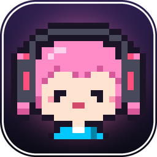
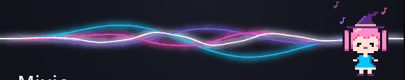
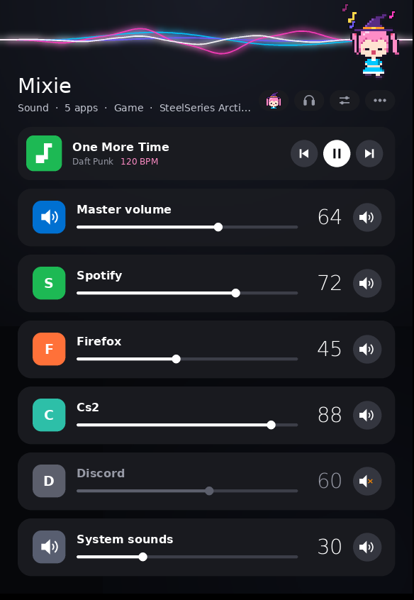
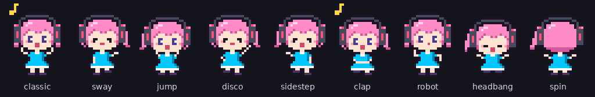
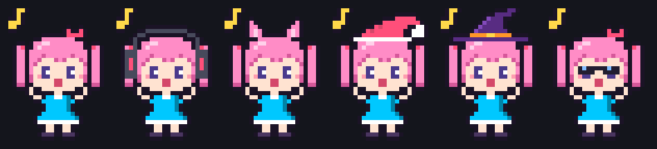
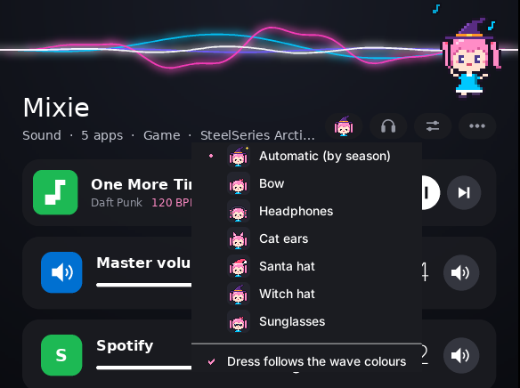
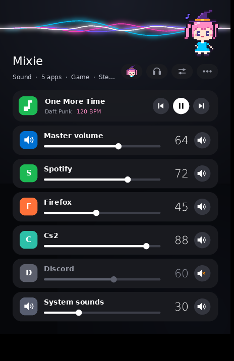
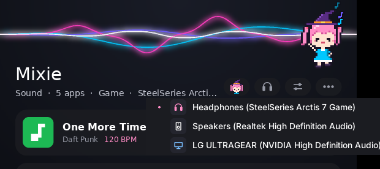

<div align="center">



# Mixie

**A per-app volume mixer for Windows, with neon sound waves and a pixel buddy who dances to your music.**

Made by [Modda-ctrl](https://github.com/Modda-ctrl)



</div>

Mixie gives every program that is playing sound its own slider – Spotify, your browser, your game,
Discord – in one small window you can park on your second monitor. It was made for one simple
thing: sliding the music down when the game gets loud, without alt-tabbing into the Windows
volume mixer.

<p align="center">
  
</p>

## Features

- **A slider per app.** Every program that plays sound gets a card with its real icon. Click or
  drag the slider, scroll the mouse wheel over a card, or hit the speaker button to mute it.
- **Hotkeys that work in-game.** Change the music or the game you are in without leaving it
  (see [Hotkeys](#hotkeys)).
- **Profiles.** *Game* turns the music down and the game up, *Music* does the opposite. Set the
  volumes the way you like and save your own version of each.
- **Lower the music when someone talks.** Mixie listens to Discord (and TeamSpeak, Mumble, Teams)
  and dips Spotify and your browser while someone is speaking, then brings them back.
- **Now playing.** Shows the song, the artist and the tempo (BPM) from Spotify or YouTube, with
  previous, play/pause and next buttons.
- **Switch audio device** between headphones, speakers and monitors in two clicks.
- **Neon sound waves** in an early-2010s style that follow the bass, mids and treble of whatever
  is playing, and change colour when the song changes.
- **Mixie, the pixel buddy**, dances in time with your music: she finds the tempo (BPM) and
  where the beats fall, and every move, bounce and music note lands on the beat. She knows nine moves – classic, sway, jump,
  disco, side-step, clap, robot, headbang and spin – and picks the ones that fit the music: calm
  songs get swaying and clapping, heavy bass gets headbanging and spins. She waits impatiently
  when nothing is playing, falls asleep after a while, waves when you hover over her and reacts
  when you click her.
- **Outfits**: bow, headphones, cat ears, santa hat, witch hat and sunglasses – or *Automatic*,
  which picks one by season. Her dress follows the colour of the waves.
- **Compact mode** for a narrower window, **always on top**, and **minimize to the tray**.
- Remembers its position, so it opens on your second monitor every time.

<p align="center">
  
</p>

<p align="center">
  
</p>

<p align="center">
  
</p>

<p align="center">
  
  
</p>

## Install

You need **Windows 10 or 11** and **Python 3.10 or newer** from
[python.org](https://www.python.org/downloads/) – tick *Add python.exe to PATH* when you install it.

1. Download **`Install Mixie.bat`** from the [latest release](../../releases) (or from this repo).
2. Double-click it. It installs Mixie into `%LOCALAPPDATA%\Mixie`, installs the Python packages it
   needs and starts it.
3. The first start creates a **Mixie** shortcut on your desktop and in the Start menu. Use that
   from then on.

Running the installer again updates Mixie and keeps your settings.

> Windows SmartScreen may warn about a downloaded `.bat` file. The file is plain text – you can
> open it in Notepad to see exactly what it does before running it.

### Run from source

```bat
git clone https://github.com/Modda-ctrl/mixie.git
cd mixie
py -m pip install -r requirements.txt
pyw mixie.py
```

Mixie also installs any missing packages by itself on the first start.

## Hotkeys

They work everywhere, including inside full-screen games. You can switch them off in the **⋯** menu.

| Keys | Action |
| --- | --- |
| `Ctrl` + `Alt` + `Up` / `Down` | Music louder / quieter (Spotify first) |
| `Ctrl` + `Alt` + `Page Up` / `Page Down` | The program you are in (your game) louder / quieter |
| `Ctrl` + `Alt` + `M` | Mute / unmute the music |
| `Ctrl` + `Alt` + `Space` | Play / pause |
| `Ctrl` + `Alt` + `Left` / `Right` | Previous / next track |
| `Ctrl` + `Alt` + `1` / `2` | Game profile / Music profile |

## Tips

- **Right-click** a card to hide a program (for example *System sounds*). Right-click again to
  show hidden programs.
- **Click the buddy.** Try it when she is asleep, too.
- The buttons at the top right are **Outfit**, **Audio device**, **Profile** and **⋯** (everything
  else).

<p align="center"></p>

## How it works

| What | How |
| --- | --- |
| Per-app volume, mute, devices | Windows Core Audio through [pycaw](https://github.com/AndreMiras/pycaw) |
| Sound waves and beat detection | WASAPI loopback capture through [SoundCard](https://github.com/bastibe/SoundCard) and an FFT with [NumPy](https://numpy.org/) |
| Tempo (BPM) and beat sync | Spectral-flux onsets, autocorrelation for the tempo (kick and bass count extra) and a comb filter for where the beats fall |
| Now playing | The window titles of Spotify and your browser – no extra permissions or APIs |
| Media buttons | Standard Windows media keys |
| Lowering the music | The peak level of the voice chat app's audio session |
| Tray icon | [pystray](https://github.com/moses-palmer/pystray) |
| UI | Tkinter, with everything drawn with [Pillow](https://python-pillow.org/) at 3× and scaled down for smooth edges |

The waves, the tray icon and song detection are optional: if a package is missing, Mixie still runs.
Only prebuilt packages are installed (`--only-binary`), so nothing is ever compiled on your machine.

## Troubleshooting

- **Something went wrong.** Mixie writes errors to `crash_log.txt` in `%LOCALAPPDATA%\Mixie`.
  If it closed unexpectedly, it starts in a safe mode next time (without the audio capture and
  song detection). Please [open an issue](../../issues) and attach the log.
- **A hotkey does nothing.** Another program may already use it. **⋯ → Show hotkeys…** lists the
  ones that are taken.
- **A game has no icon.** Some games with anti-cheat do not let other programs read their icon,
  so Mixie shows a letter instead.

## Building the installer

`Install Mixie.bat` is one file that contains the installer and `mixie.py`. After changing
`mixie.py`, rebuild it with:

```bat
py installer\build_installer.py
```

## Credits

Mixie is made by **[Modda-ctrl](https://github.com/Modda-ctrl)** – the app, the pixel art and
the dance moves. Bug reports and ideas are welcome in the [issues](../../issues).

## License

[MIT](LICENSE) © Modda-ctrl
