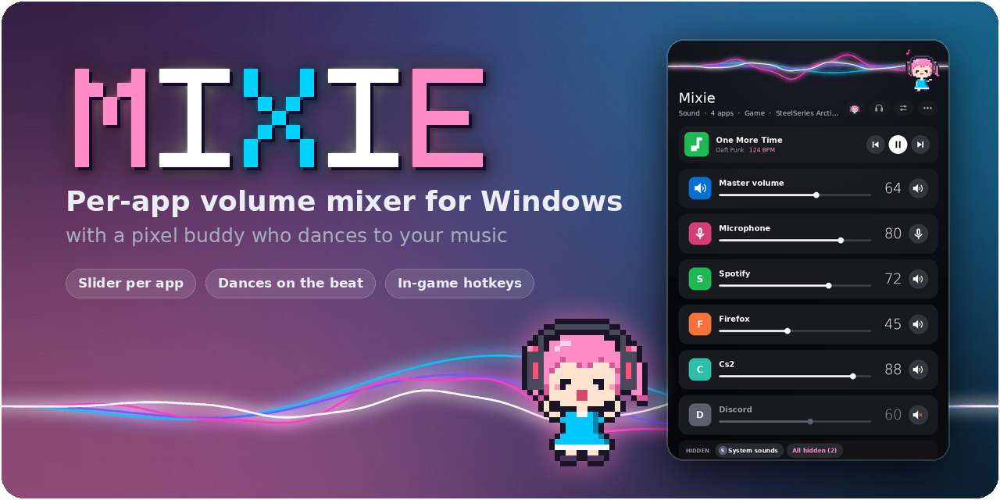
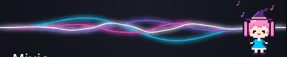
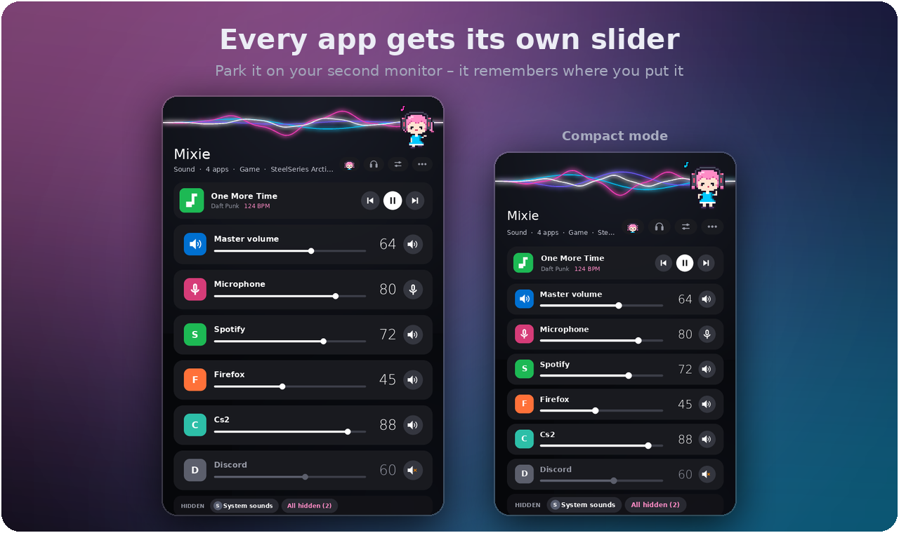
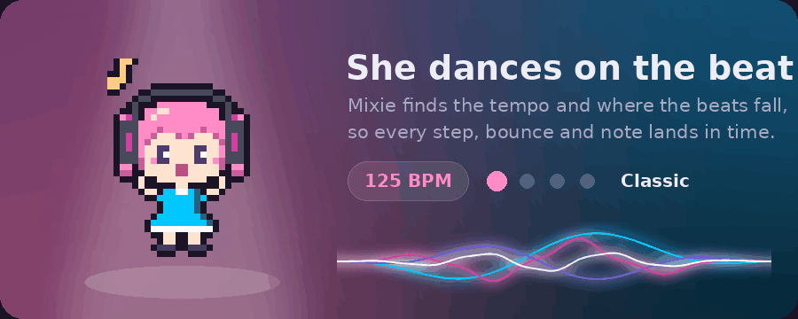
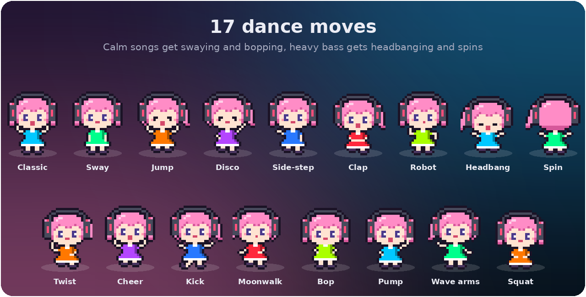
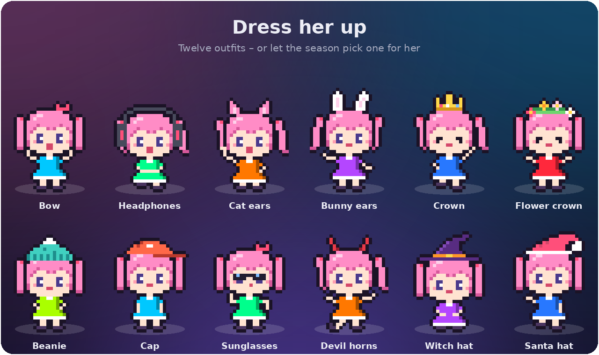
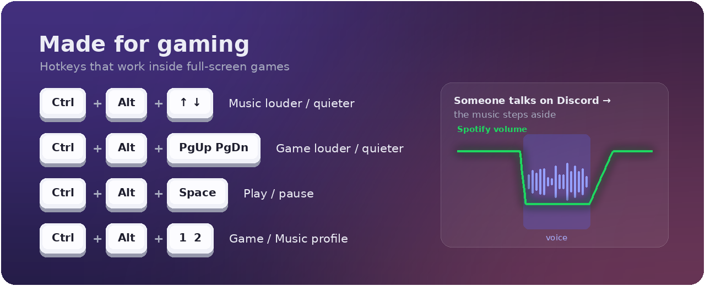
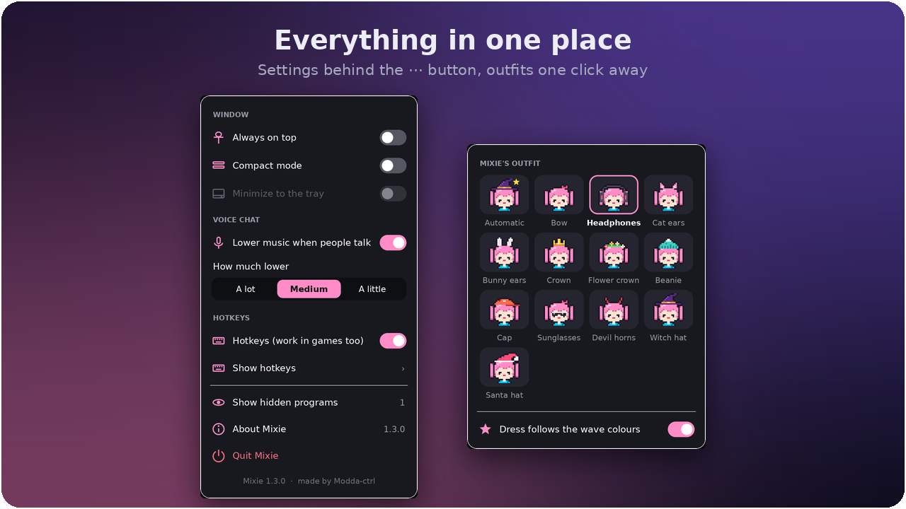

<p align="center">
  
</p>

<p align="center">
  <a href="../../releases/latest"></a>
  
  
  <a href="LICENSE"></a>
</p>

<p align="center">
  <a href="#-install"><b>Install</b></a> ·
  <a href="#-features"><b>Features</b></a> ·
  <a href="#-hotkeys"><b>Hotkeys</b></a> ·
  <a href="#-how-it-works"><b>How it works</b></a> ·
  <a href="CHANGELOG.md"><b>Changelog</b></a>
</p>

---

**Mixie** gives every program that is playing sound its own slider – Spotify, your browser, your game,
Discord – in one small window you can park on your second monitor. It was made for one simple thing:
turning the music down when the game gets loud, without alt-tabbing into the Windows volume mixer.

And while you play, **Mixie** – the pixel buddy in the corner – dances to your music, right on the beat.

<p align="center">
  
</p>

## ✨ Features

<p align="center">
  
</p>

- **A slider per app.** Every program that plays sound gets a card with its real icon. Drag the slider,
  scroll over a card, or hit the speaker button to mute it.
- **Now playing.** Song, artist and tempo from Spotify or YouTube, with previous, play/pause and next.
- **Profiles.** *Game* turns the music down and the game up, *Music* does the opposite – or save your own.
- **Switch audio device** between headphones, speakers and monitors in two clicks.
- **Compact mode**, **always on top**, **minimize to the tray** – and it remembers where you put it.

<p align="center">
  
</p>

- **She dances on the beat.** Mixie works out the tempo (BPM) and where the beats fall, so every move,
  bounce and music note lands in time.
- **17 dance moves** – from swaying, bopping and the twist to the moonwalk, high kicks, fist pumps,
  headbanging and spins – picked to fit the music: calm songs get the gentle ones, heavy bass gets the wild ones.
  She keeps the beat through breaks without drums, so she never stops mid-song.
- **She has a life of her own.** She blinks, looks around and stretches while she waits for music, falls
  asleep after a while, waves when you hover over her and has something to say when you click her.
- **Neon sound waves** in an early-2010s style follow the bass, mids and treble, and change colour
  with every new song.

<p align="center">
  
</p>

<p align="center">
  
</p>

- **Twelve outfits.** Bow, headphones, cat ears, bunny ears, crown, flower crown, beanie, cap, sunglasses,
  devil horns, witch hat and santa hat – or *Automatic*, which picks one by season. Her dress follows the colour
  of the waves.

<p align="center">
  
</p>

- **Hotkeys that work in-game.** Change the music or the game you are in without leaving it.
- **The music steps aside when someone talks.** Mixie listens to Discord (and TeamSpeak, Mumble, Teams) and
  dips Spotify and your browser while someone is speaking, then brings them back.

## 📥 Install

You need **Windows 10 or 11** and **Python 3.10 or newer** from
[python.org](https://www.python.org/downloads/) – tick *Add python.exe to PATH* during the install.

1. Download **`Install Mixie.bat`** from the [latest release](../../releases/latest).
2. Double-click it. It installs Mixie into `%LOCALAPPDATA%\Mixie`, sets up the Python packages it needs
   and starts it.
3. The first start puts a **Mixie** shortcut on your desktop and in the Start menu.

Running the installer again updates Mixie and keeps your settings.

> [!NOTE]
> Windows SmartScreen may warn about a downloaded `.bat` file. It is plain text – open it in Notepad to see
> exactly what it does before you run it.

<details>
<summary><b>Run from source instead</b></summary>

```bat
git clone https://github.com/Modda-ctrl/Mixie.git
cd Mixie
py -m pip install -r requirements.txt
pyw mixie.py
```

Mixie also installs any missing packages by itself on the first start.
</details>

## ⌨️ Hotkeys

They work everywhere – including inside full-screen games. Switch them off in the **⋯** menu.

| Keys | Action |
| --- | --- |
| <kbd>Ctrl</kbd> + <kbd>Alt</kbd> + <kbd>↑</kbd> / <kbd>↓</kbd> | Music louder / quieter (Spotify first) |
| <kbd>Ctrl</kbd> + <kbd>Alt</kbd> + <kbd>Page Up</kbd> / <kbd>Page Down</kbd> | The program you are in (your game) louder / quieter |
| <kbd>Ctrl</kbd> + <kbd>Alt</kbd> + <kbd>M</kbd> | Mute / unmute the music |
| <kbd>Ctrl</kbd> + <kbd>Alt</kbd> + <kbd>Space</kbd> | Play / pause |
| <kbd>Ctrl</kbd> + <kbd>Alt</kbd> + <kbd>←</kbd> / <kbd>→</kbd> | Previous / next track |
| <kbd>Ctrl</kbd> + <kbd>Alt</kbd> + <kbd>1</kbd> / <kbd>2</kbd> | Game profile / Music profile |

## 💡 Tips

- The buttons at the top right are **Outfit**, **Audio device**, **Profile** and **⋯** (settings).
- **Right-click** a card to hide a program (for example *System sounds*); right-click again to bring it back.
- **Click Mixie.** Try it while she's asleep, too.

<p align="center">
  
</p>

## 🔧 How it works

| What | How |
| --- | --- |
| Per-app volume, mute, devices | Windows Core Audio through [pycaw](https://github.com/AndreMiras/pycaw) |
| Sound waves | WASAPI loopback capture through [SoundCard](https://github.com/bastibe/SoundCard) and an FFT with [NumPy](https://numpy.org/) |
| Tempo and beat sync | Spectral-flux onsets, autocorrelation for the tempo (kick drum and bass count extra) and a comb filter for where the beats fall |
| Now playing | The window titles of Spotify and your browser – no logins, permissions or APIs |
| Media buttons | Standard Windows media keys |
| Lowering the music | The live level of the voice-chat app's audio session |
| Tray icon | [pystray](https://github.com/moses-palmer/pystray) |
| Interface | Tkinter, with everything drawn by [Pillow](https://python-pillow.org/) at 3× and scaled down for smooth edges |

The waves, the tray icon and song detection are optional – if a package is missing, Mixie still runs.
Only prebuilt packages are installed (`--only-binary`), so nothing is compiled on your machine.

## 🩺 Troubleshooting

- **Mixie closed or something went wrong.** Errors are written to `crash_log.txt` in `%LOCALAPPDATA%\Mixie`.
  After an unexpected close, Mixie starts in a safe mode (without audio capture and song detection).
  Please [open an issue](../../issues/new/choose) and paste the log.
- **A hotkey does nothing.** Another program may already use it – **⋯ → Show hotkeys…** lists the taken ones.
- **A game shows a letter instead of its icon.** Some games with anti-cheat don't let other programs read
  their icon.

## 🛠️ Building the installer

`Install Mixie.bat` is a single file that contains both the installer and `mixie.py`. After changing
`mixie.py`, rebuild it with:

```bat
py installer\build_installer.py
```

## ❤️ Credits

Mixie is made by **[Modda-ctrl](https://github.com/Modda-ctrl)** – the app, the pixel art and the dance moves.
Bug reports and ideas are very welcome in the [issues](../../issues/new/choose).

## 📄 License

[MIT](LICENSE) © Modda-ctrl
